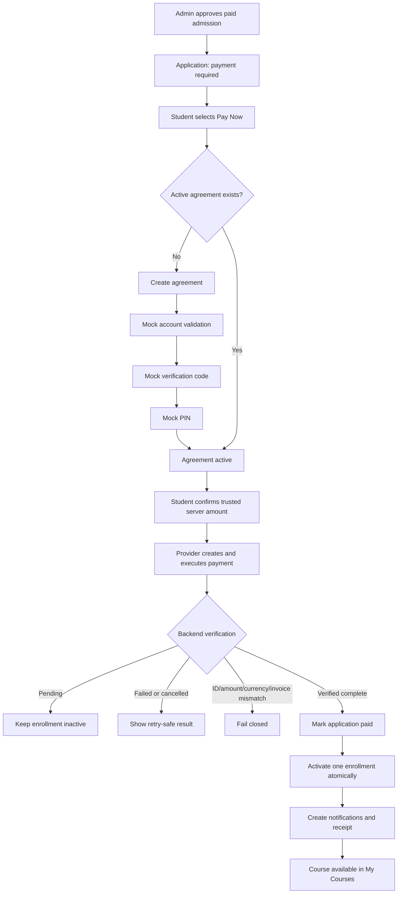
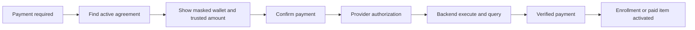
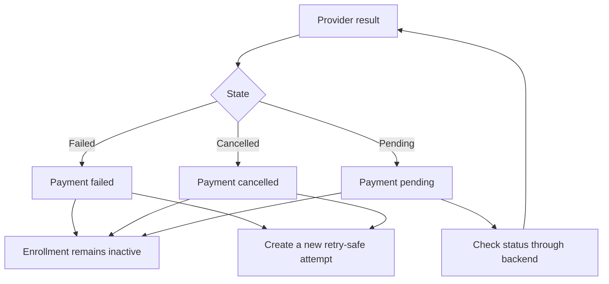
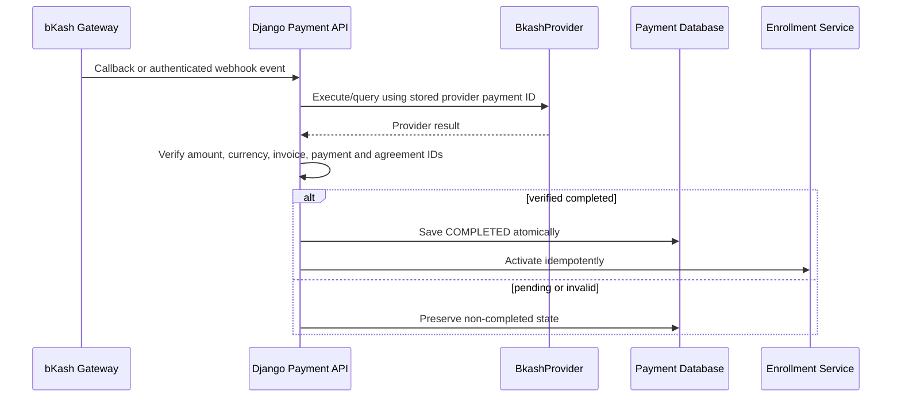

# bKash admission payment flow

The browser never decides that a payment succeeded. Every success UI reads a completed transaction produced by the backend verifier. The mock account, verification code, and PIN exist only for local development; sandbox and live must use bKash-hosted credential entry.

## Returning payment

## Failure and retry

## Callback and webhook boundary

